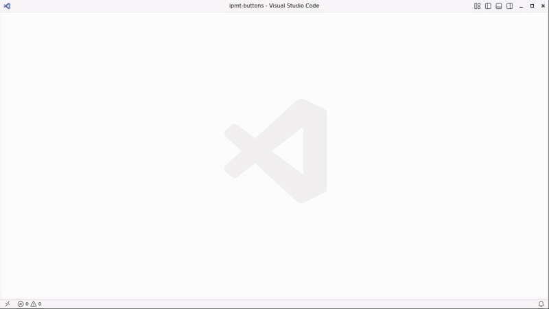
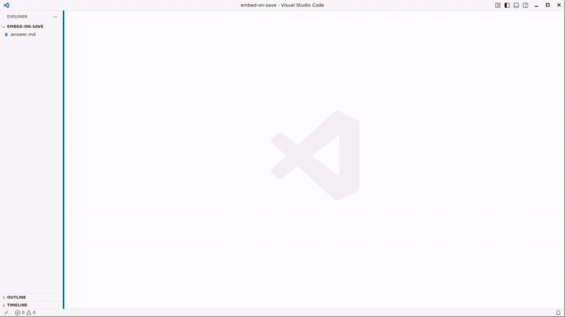

# infinite.pm — VS Code extension

Language support for [Infinite Process Modeling (infinite.pm)](https://infinite.pm) inside VS Code: ipmt syntax highlighting, hover, diagnostics, semantic colors for event / thing / concept nodes, and embed-on-save that keeps committed SVG diagrams in sync with their source. Published on the [Visual Studio Marketplace](https://marketplace.visualstudio.com/publishers/infinite-pm).

<!-- demo-assets:start -->
<!-- Generated by vscode-infinite-pm-dev/cmd-dev/assets-dist. Do not edit by hand. -->

## See it work

### Preview a `.ipmt` file, beside the source or in its place



### Diagrams in Markdown: rendered as you type, written on save



More scenarios — live refresh, includes, diagnostics — with step-by-step stills:
[vscode-infinite-pm-demo](https://github.com/infinite-pm/vscode-infinite-pm-demo).

<!-- demo-assets:end -->

## Features

- **Syntax highlighting** for `.ipmt` files and for ` ```ipmt ` fences inside any Markdown document. Editor pane and markdown preview share the same Go-side tokenizer ([ipm-rpc](https://github.com/infinite-pm/ipm-tools/blob/main/docs/ipm-rpc.md) → `pkg/ipmtokens`), so the two panes paint identical colors token-for-token.
- **Fence meta and pragma aware**: an ipmt fence can carry meta tokens after the language id (` ```ipmt embed=false `, ` ```ipmt unresolved `, …), and the first non-empty line of a block can be a `# ipmt:` pragma. The meta tokens are tolerated so the fence still highlights as ipmt, and the pragma paints as an ordinary ipmt comment. ` ```ipmt-invalid ` fences mark deliberate negative examples and are intentionally *not* highlighted as ipmt. What these selectors mean to the engine is documented in ipm-tools ([docs/ipmt-unresolved.md](https://github.com/infinite-pm/ipm-tools/blob/main/docs/ipmt-unresolved.md)).
- **Semantic colors** distinguish event (orange), thing (green), and concept (blue) nodes regardless of theme. An unmarked label is an event; things need `::t`, concepts `::c`. Edge arrows are bold by SST relation (Leads-to orange, Part-of green, eXpresses blue, Near-to gray); `::e`/`::t`/`::c` markers are bold; tooltips and relation letters are normal weight. All colors come from the palette source of truth in the [ipm-tools](https://github.com/infinite-pm/ipm-tools) repo (`pkg/ipmtokens/palette.json`) and are code-generated by `scripts/gen-palette.ts` into `src/palette.gen.ts`, `package.json` (editor pane), and `media/ipm-preview.css` (markdown preview).
- **Diagnostics in the Problems panel** — parse errors and the IPMV* validation findings from `pkg/ipm/validate`.
- **Hover documentation** for `::e`/`::t`/`::c`/`::a`/`::tip` markers and all arrow forms (`-->`, `<--`, `---`, `--::P-->`, etc.).
- **Embed on save**: saving a `.md` file with ipmt blocks triggers the LSP server's `ipm.embed` command. Committed SVGs under `_ipm/` get refreshed; marker hashes update; the markdown preview reloads the new diagrams automatically.
- **Include refresh**: saving (or otherwise writing) a `.ipmt` file re-embeds every Markdown file that pulls it in via `<!-- ipm-include -->`, scoped to the git repository containing it (falling back to the workspace folder). Dirty buffers are skipped, changes under generated trees (`temp/`, `tmp/`, `out/`, `dist/`, … plus `ipm.embedIgnore`) are ignored, a burst of writes is coalesced into one scan once it has been quiet ~500ms, and the whole path is gated by `ipm.embedOnSave` — note this **writes committed SVGs across the repo**, not just the file you saved.
- **Live SVG refresh** as you type: the LSP's `ipm.embedBuffer` renders every ipmt block in the open buffer (in-memory, no disk write) and the preview swaps the rendered `` for a `data:` URL until the next save. Gated by `ipm.liveRefresh`.
- **LSP auto-restart** when the `ipm-rpc` binary file changes — useful while iterating on the server (`go install ./cmd/ipm-rpc`). Gated by `ipm.restartOnBinaryChange`.
- **`.ipmt` preview pane** — clicking the "Open Preview to the Side" icon on a `.ipmt` file opens a webview that renders the parsed SVG and re-renders as you type. The SVG is rendered in-memory by `ipm.embedBuffer` and **never written to disk** — for `.ipmt` files the source itself IS the graph. The preview supports **pan + zoom** with the same UX as VS Code's built-in image preview: mouse wheel to zoom centered on the cursor; `Ctrl/Cmd` + `=` / `-` / `0` to step in / step out / reset; click to step zoom (Shift+click for the other direction); drag to pan; a bottom-right zoom indicator that appears while zoomed (click to reset). Vectors stay crisp at every zoom level because the SVG element is resized on each step rather than CSS-scaled. Your zoom/pan persists across debounced edits.

## Colours

The **whole node** is one colour by kind: the title (quoted or bare), the alias, and the `::e` / `::t` / `::c` marker. An unmarked node is an event. The generic string colour is never used for a node title. The quotes around a title take the node colour too, not the bracket-pair colour: `"` is not declared as a bracket in `language-configuration.json` (it still auto-closes and surrounds). Only tooltips (`--"text"-->`, `"text" ::tip`) keep their own colour.

| Kind | Semantic type | TextMate scope: title / marker | Dark theme | Light theme |
|---|---|---|---|---|
| event (unmarked or `::e`) | `ipmEvent` | `entity.name.type.event.ipmt` / `storage.type.node.event.ipmt` | `#ff8000` 6.55:1 | `#a65300` 5.44:1 |
| thing (`::t`) | `ipmThing` | `entity.name.type.thing.ipmt` / `storage.type.node.thing.ipmt` | `#6fc24f` 7.46:1 | `#2d6e1f` 6.25:1 |
| concept (`::c`) | `ipmConcept` | `entity.name.type.concept.ipmt` / `storage.type.node.concept.ipmt` | `#6c8ebf` 4.91:1 | `#1a5f9e` 6.62:1 |

Contrast is the WCAG ratio against the editor background: `#1f1f1f` for dark (so also fine on `#121314` and black), `#ffffff` for light. Every colour in the palette is at least 4.5:1 (AA); `src/__tests__/colours.test.ts` and ipm-tools' `palette_contrast_test.go` compute it. A node with an alias shows its long title one step softer (`ipmEvent.hasAlias` etc., also AA). Arrows by relation reuse the kind colours: leads-to = event, part-of = thing, expresses = concept, near-to grey. Token spans never get a background colour, in the editor or in the preview.

**Two layers carry the same colours.**

1. Semantic tokens from the language server (`ipmEvent`, `ipmThing`, `ipmConcept`, with the `alias`, `hasAlias` and `marker` modifiers) are coloured by `editor.semanticTokenColorCustomizations`. The server paints a quoted title as its node kind, not as `ipmString`.
2. The TextMate grammar scopes the title, alias and marker by kind too, and `editor.tokenColorCustomizations.textMateRules` colours those scopes. This is what you see with semantic highlighting off, or before the server answers. Limit: the grammar only sees one line, so a bare re-mention of a thing declared elsewhere (`... --> wearB`) reads as an event until semantic tokens arrive.

**Light and dark.** One value cannot reach 4.5:1 on both backgrounds, so the defaults are the dark values plus a `"[*Light*]"` block inside each of the two customisation settings. VS Code applies a `[name]` block to every colour theme whose name matches (`*` is a wildcard), so Light 2026, Default Light Modern, Visual Studio Light and Default High Contrast Light get the light values. Limit: a light theme whose name does not contain "Light" gets the dark values; add your own `"[Theme Name]"` block under `editor.tokenColorCustomizations` / `editor.semanticTokenColorCustomizations` in your settings to fix that. The markdown preview does the same with the `vscode-light` / `vscode-high-contrast-light` body classes (`media/ipm-preview.css`).

**Semantic highlighting stays on.** The extension sets `editor.semanticHighlighting.enabled: true` as a language-scoped default for `[ipmt]` and `[markdown]`, so a theme that says `configuredByTheme` cannot switch it off for our languages. A value you set yourself for those languages still wins.

The colours are generated: edit `pkg/ipmtokens/palette.json` in ipm-tools (`fg` dark, `fgLight` light) and run `npm run gen-palette` (set `IPM_TOOLS_DIR` to use an ipm-tools checkout other than the sibling `../ipm-tools`).

## Installation

Install **infinite.pm** from the
[Visual Studio Marketplace](https://marketplace.visualstudio.com/items?itemName=infinite-pm.vscode-infinite-pm),
or from a shell:

```bash
code --install-extension infinite-pm.vscode-infinite-pm
```

Every release also lands on the
[releases page](https://github.com/infinite-pm/vscode-infinite-pm/releases) as one
`.vsix` per platform with `SHA256SUMS` and build provenance — see
[RELEASING.md](RELEASING.md). Open VSX (VSCodium, Cursor, Windsurf, Gitpod,
code-server) is not published yet.

To run something that has not been released yet — a fix on `main`, say — get a
`.vsix` one of two ways:

- **From CI** — the `package` job of every green build uploads one per platform as
  a workflow artifact (kept 14 days; needs access to the repo's Actions tab). The
  files are target-qualified, e.g. `vscode-infinite-pm-linux-x64-0.4.1.vsix`.
- **Build it yourself** — see [Development](#development) below (needs the sibling
  `ipm-tools` checkout), then `npm run package`.

Then install the file you obtained:

```bash
code --install-extension vscode-infinite-pm-<target>-X.Y.Z.vsix
```

The extension's LSP features are powered by a Go binary, **`ipm-rpc`**, which is
**bundled in the published `.vsix`** — there's nothing extra to install.
Each build is platform-specific (`linux-amd64`, `darwin-arm64`, …) and ships the
matching `ipm-rpc` under `bin/<os>-<arch>/`; the extension uses it automatically.

(If you run multiple VS Code profiles, make sure `code` points at the one you want — `--install-extension` lands in whichever profile the resolved `code` binary targets.)

**Bringing your own `ipm-rpc`** (optional — for development against a local build):
set `ipm.serverPath` to a binary you built, or put one on your `PATH` with
`go install github.com/infinite-pm/ipm-tools/cmd/ipm-rpc@latest`. Both override the
bundled copy. Or open this workspace in VS Code, press `F5`, and run the extension
in a development host.

**Workspace trust.** The extension declares *limited* support for restricted
workspaces. Opening an untrusted folder gives you full highlighting (grammars are
static), but the `ipm-rpc` server is not started and embed-on-save writes nothing —
starting the server spawns an executable, and embedding writes SVGs into your
folder. Trust the folder ("Workspaces: Manage Workspace Trust") and the server
starts immediately, no reload needed. This is also why `ipm.serverPath` is a
`machine-overridable` setting: a repository you clone cannot point the extension at
an executable of its choosing.

**If no `ipm-rpc` can be resolved** (e.g. an unsupported platform with no bundled
binary and none on `PATH`), the extension still provides syntax highlighting via its
TextMate grammar — you just don't get the LSP-driven features (diagnostics, hover,
semantic colors, embed-on-save, live refresh, and the `.ipmt` preview — which
renders an "ipm-rpc not running" banner instead). A one-shot notification explains this when it happens.

## Settings

| Setting | Default | Meaning |
| --- | --- | --- |
| `ipm.serverPath` | `""` | Path to the `ipm-rpc` binary. *(machine-overridable: settable per user or per remote machine, never by a workspace.)* If empty, the extension searches `PATH` for `ipm-rpc`; if still not found, falls back to the `ipm-rpc` bundled in the extension's `bin/<os>-<arch>/` directory. |
| `ipm.embedOnSave` | `true` | When you save a `.md` file with ipmt blocks, refresh the committed SVGs and marker hashes via `ipm.embed`. |
| `ipm.embedIgnore` | `[]` | Extra directory names whose `.ipmt` changes never trigger an include refresh, on top of the built-in `temp`, `tmp`, `node_modules`, `.git`, `out`, `dist`, `target`, `build`. Matched as a path segment anywhere. |
| `ipm.embedDebounceMs` | `0` | Debounce period before embed-on-save fires. `0` = no debounce; embed runs on every save. Raise to e.g. `800` if you save rapidly during editing. |
| `ipm.liveRefresh` | `true` | Refresh ipmt diagrams in the markdown preview as you type (no save needed). Renders are in-memory via `ipm.embedBuffer`; the on-disk SVGs are untouched until you save and `ipm.embed` runs. |
| `ipm.liveRefreshDebounceMs` | `300` | Idle time (ms) after the last keystroke before live-refresh fires. `0` = re-render on every change (heavier). |
| `ipm.restartOnBinaryChange` | `true` | Watch the resolved `ipm-rpc` binary path; auto-restart the LSP client when the binary file changes (e.g. after `go install ./cmd/ipm-rpc`). Disable if your platform's `fs.watch` gives spurious events. |

## Commands

| Command palette entry | What it does |
| --- | --- |
| **infinite.pm: Restart Language Server** | Stops the LSP client and starts it again (re-reading the configured `ipm-rpc` binary). |
| **infinite.pm: Show Server Info (path + version)** | Shows the resolved binary path, its `--version` output, and the current LSP connection state via a notification + the output channel. |
| **infinite.pm: Open as Preview** | (`.ipmt` files only) Replaces the active source pane with a webview rendering the SVG. The source tab is closed; `Shift+Ctrl+V` again (or "Reopen as source file") brings it back. Icon: `$(preview)` — the same codicon Markdown uses for its "Open as Preview" action, which does the same thing to a tab. |
| **infinite.pm: Open Preview to the Side** | (`.ipmt` files only) Same as above but opens beside the source pane — both stay visible. Icon: `$(open-preview)` (same codicon markdown uses for side preview). |
| **infinite.pm: Reopen as source file** | (visible only when an ipmt preview is the active panel) Flips back from the preview to the source text document in the same column; the preview tab is closed. Title + icon (`$(file-code)`) mirror VS Code Insiders' current "back to source" action. |
| **infinite.pm: Force Re-embed Current File** | (markdown files only) Runs `ipm.embed` on the active `.md` file immediately, regardless of the `ipm.embedOnSave` setting — refreshes its committed SVGs and marker hashes on demand. The file is saved first if dirty (`ipm.embed` reads from disk); invoked from a focused markdown preview it targets the most recently active markdown file. |
| **infinite.pm: Force Re-embed All Markdown Files in Workspace** | Runs `ipm.embed` across every markdown file in the workspace (excluding `node_modules`), refreshing all committed SVGs and marker hashes. Asks for confirmation first, then runs under a cancellable progress notification. |
| **infinite.pm: Force Re-embed All Markdown Files in Current Repo** | Like the workspace command — same confirmation and cancellable progress — but scoped to the git repository containing the active editor. |
| **infinite.pm: Copy Path** | (ipmt preview panel only) Copies the absolute path of the source `.ipmt` file to the clipboard. Also on the preview's title bar / context menu. |
| **infinite.pm: Copy Relative Path** | (ipmt preview panel only) Copies the workspace-relative path of the source `.ipmt` file. Also on the preview's title bar / context menu. |
| **infinite.pm: Reveal in Explorer View** | (ipmt preview panel only) Reveals the source `.ipmt` file in the Explorer. Also on the preview's title bar / context menu. |

The editor title bar of a `.ipmt` file shows two distinct preview icons (in-place + side-by-side); the preview pane shows the "back to source" icon. The icons + behavior mirror VS Code's markdown preview UX so muscle memory carries over.

## What gets contributed to VS Code

- A new language: `ipmt` (file extension `.ipmt`).
- Two TextMate grammars: one for standalone `.ipmt` files, one for markdown injection. (These are the cold-start fallback when `ipm-rpc` isn't running; once the LSP is up, semantic tokens take over.)
- 10 custom semantic token types: `ipmEvent`, `ipmThing`, `ipmConcept`, `ipmRelation`, `ipmArrow`, `ipmTypeMarker`, `ipmComment`, `ipmString`, `ipmTooltip`, `ipmUnresolved`.
- 7 token modifiers: `alias`, `hasAlias`, `marker`, `leadsTo`, `partOf`, `expresses`, `nearTo`.
- Default color customizations (an unmarked label is an event, things need `::t`; generated from the ipm-tools palette): event=orange, thing=green, concept=blue, arrows bold, kind markers bold, tooltips yellow italic.
- An LSP client that connects to `ipm-rpc`.
- A `workspace.onDidSaveTextDocument` listener that runs `ipm.embed` for saved markdown files (gated by `ipm.embedOnSave`).
- A live-refresh listener (onChange / onOpen / activation-time scan) that calls `ipm.embedBuffer` to paint in-memory SVG data URLs into the markdown preview before save (gated by `ipm.liveRefresh`).
- A markdown-it fence-renderer override that uses LSP-emitted tokens (piggybacked on each `ipm.embedBuffer` response) to paint ipmt code blocks in the markdown preview with the exact same palette as the editor pane.

## Development

Building from source requires a checkout of
[ipm-tools](https://github.com/infinite-pm/ipm-tools) **next to this repo**
(`../ipm-tools`) — the palette codegen reads its source of truth from there
(see below).

```bash
npm install
npm run gen-palette       # regenerate from ../ipm-tools/pkg/ipmtokens/palette.json
npm run gen-palette:check # CI guard — exits non-zero on drift
npm run build             # webpack production bundle (runs gen-palette:check first)
npm run watch             # auto-rebuild on changes
npm test                  # node:test + tsx against the in-tree unit tests (runs gen-palette:check first)
npm run package           # produce the .vsix (warns if bin/<goos>-<goarch>/ipm-rpc is absent,
                          #   in which case the vsix relies on PATH / ipm.serverPath)
npm run ci                # local equivalent of the CI pipeline
```

Press `F5` from VS Code to launch a development host with the extension loaded.

The token palette's single source of truth lives in the [ipm-tools](https://github.com/infinite-pm/ipm-tools) repo at `pkg/ipmtokens/palette.json`. `scripts/gen-palette.ts` reads it (from the sibling `../ipm-tools`) and generates `src/palette.gen.ts`, the `editor.semanticTokenColorCustomizations.rules` in `package.json`, and the `.ipm-*` classes in `media/ipm-preview.css`. The drift check (`gen-palette:check`) runs before every `build` and `test`, so editing a generated file or the palette without regenerating is caught immediately. To change colors, edit `palette.json` in ipm-tools and run `npm run gen-palette`.

## Related projects

- [ipm-tools](https://github.com/infinite-pm/ipm-tools) — `ipm-rpc` language server, `md-embed` CLI, ipmt parser, SVG renderer, validator.
- [ipm-intro](https://github.com/infinite-pm/ipm-intro) — newcomer documentation for the modeling notation.
- [infinite.pm](https://infinite.pm) — the project.

## Authors & credits

Created and maintained by [mj41](https://mj41.cz), spec-driven / "vibe-coded"
with help from Claude (Opus) and other AI coding agents. See [`AUTHORS.md`](AUTHORS.md).

## License

See [LICENSE](LICENSE).
